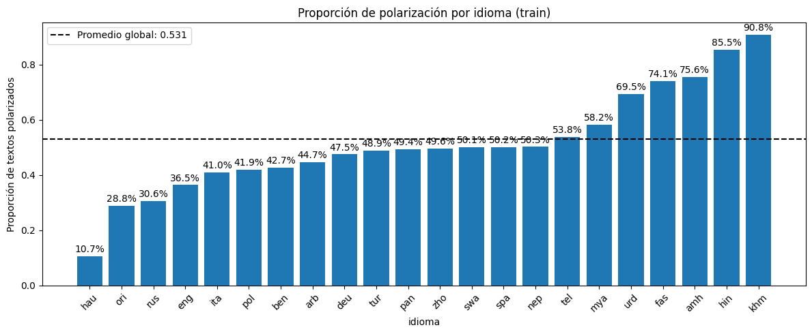
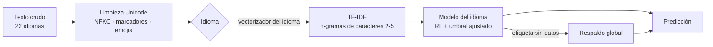
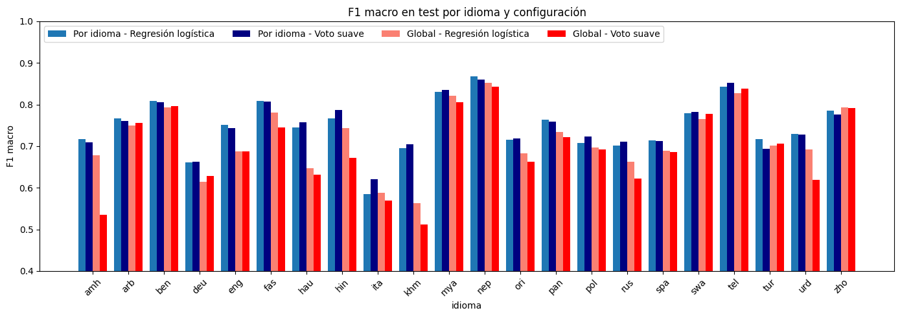
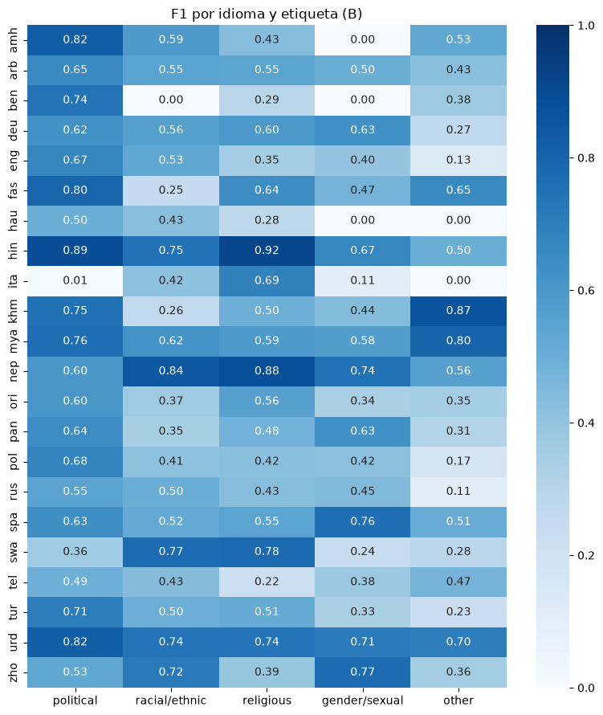

<div align="center">

<br/>

# Detección multilingüe de polarización con metamodelos por idioma

### **SemEval-2026, Task 9**

#### Ángel J. Zamora, Ángel N. Pérez

*Instituto de Investigaciones en Matemáticas Aplicadas y en Sistemas*<br/>
*Universidad Nacional Autónoma de México*

Noviembre, 2026

</div>

> **Notas de los autores.** El proyecto fue realizado con base en las notas del curso Procesamiento de Lenguaje Natural, impartido para la Licenciatura en Ciencia de Datos por la Dra. Helena Gómez Adorno y la Dra. Gemma Bel-Enguix.

---

## Resumen

La polarización en línea, entendida como contenido que refleja divisiones marcadas u hostilidad entre grupos sociales, políticos, religiosos, étnicos o de género, es un fenómeno cuya detección automática se complica por la diversidad lingüística y cultural. Este trabajo aborda las subtareas 1 (detección binaria) y 2 (tipo de polarización, multietiqueta) de SemEval-2026 Task 9 sobre el corpus POLAR, que contiene 106,969 textos en 22 idiomas. Proponemos un metamodelo por idioma que enruta cada texto a un vectorizador TF-IDF de n-gramas de caracteres y a un clasificador entrenados para su idioma. Para la subtarea 2, ese metamodelo se combina con un clasificador multietiqueta con umbral ajustado por etiqueta y con un modelo global de respaldo para las combinaciones de idioma y etiqueta con pocos ejemplos. En la partición de prueba, el metamodelo alcanza un F1 macro promedio por idioma de 0.748 en la subtarea 1 y de 0.500 en la subtarea 2. Supera al modelo global equivalente en 20 de 22 idiomas en la primera subtarea y en los 22 en la segunda (prueba de Wilcoxon, $p$ < 0.001). Un análisis con la polarización verdadera muestra que la detección de polarización es el principal cuello de botella: con una subtarea 1 perfecta, el F1 de la subtarea 2 subiría 14 puntos.

---

## 1. Introducción

La polarización es contenido que refleja divisiones marcadas u hostilidad entre grupos políticos, religiosos, étnicos, de género u otros grupos identitarios. Su detección facilita la modelación de plataformas y el estudio del discurso en línea. Sin embargo, la mayoría de recursos disponibles que abordan esta problemática está disponible en idiomas ampliamente hablados, como el inglés, dificultando su trato en lenguas de bajos recursos. 

Para la edición 2026 del Taller Internacional sobre Evaluación Semántica (SemEval), la tarea POLAR presenta la primera tarea compartida dedicada a detectar y analizar la polarización en línea a través del discurso en redes sociales multilingües, multiculturales y de múltiples eventos. Propone tres subtareas sobre textos cortos de redes sociales en 22 idiomas.

Este trabajo se centra en las dos primeras subtareas. Se restringe deliberadamente a representaciones clásicas (TF-IDF y modelos lineales) para medir con precisión qué decisiones de modelado importan en un escenario de muchos idiomas con pocos miles de ejemplos cada uno.

**Contribuciones:**

1. Un preprocesamiento único para los 22 idiomas, basado en propiedades Unicode y no en reglas de cada lengua, que conserva las marcas combinantes de las escrituras índicas y del sudeste asiático.
2. `ClasificadorPorIdioma`, un metamodelo compatible con `scikit-learn` que entrena y enruta un modelo por idioma, y `Multietiqueta`, un clasificador con umbral por etiqueta y respaldo global.
3. Una comparación controlada, con pruebas pareadas por idioma, entre modelos por idioma y globales, ensambles, cascada jerárquica y cadenas de clasificadores.
4. Un análisis de error que identifica dos causas dominantes: los errores de la subtarea 1 y los problemas de anotación entre particiones, como el italiano.

---

## 2. Tarea y datos

### 2.1 Subtareas

| Subtarea | Tipo | Etiquetas |
|:--|:--|:--|
| 1. Detección de polarización | Binaria | `polarization` |
| 2. Tipo de polarización | Multietiqueta | `political`, `racial/ethnic`, `religious`, `gender/sexual`, `other` |
| 3. Manifestación *(fuera del alcance)* | Multietiqueta | `stereotype`, `vilification`, `dehumanization`, `extreme_language`, `lack_of_empathy`, `invalidation` |

La métrica oficial es el F1 macro. En la subtarea 1 se promedia sobre ambas clases; en la subtarea 2, sobre el F1 de la clase positiva de las cinco etiquetas:

$$F_1^{\text{macro}} = \frac{1}{|L|}\sum_{\ell \in L} \frac{2\,VP_\ell}{2\,VP_\ell + FP_\ell + FN_\ell}$$

Como resumen principal reportamos el promedio por idioma, que le da el mismo peso a cada lengua. Al juntar todos los idiomas, los errores de un idioma se compensan con los aciertos de otro, y las diferencias entre modelos quedan ocultas (S5.1).

### 2.2 Corpus

El corpus contiene 73,681 textos de entrenamiento y 33,288 de prueba en 22 idiomas. Cada idioma reserva cerca del 31% de sus textos para prueba. Las etiquetas son jerárquicamente consistentes: ningún texto no polarizado tiene tipo, y todo texto polarizado tiene al menos uno.

<p align="center"></p>

<p align="center"><em><b>Figura 1.</b> Proporción de textos polarizados por idioma en entrenamiento. El promedio global es de 53.1%, pero varía de 10.7% (hausa) a 90.8% (jemer).</em></p>

Aunque las clases están balanceadas a nivel global, la proporción de polarización cambia drásticamente entre idiomas (Figura 1). Un modelo único, con un solo intercepto y un solo umbral, no puede adaptarse a esa variación. `political` domina en 16 idiomas. En suajili e italiano predomina `racial/ethnic`, y en jemer y birmano, `other`. En urdu, el 71% de los textos polarizados tiene los cinco tipos a la vez, lo que sugiere un criterio de anotación distinto. El italiano no tiene ningún ejemplo de `political` ni de `other` en entrenamiento, pero tiene 412 y 219 en prueba.
- **Textos cortos.** La mediana es de 89 caracteres, y la longitud no distingue las clases (94 frente a 84 caracteres).

Guiamos el diseño con base a los hallazgos anteriores.

---

## 3. Metodología



<p align="center"><em><b>Figura 2.</b> Arquitectura del metamodelo por idioma.</em></p>

### 3.1 Preprocesamiento

Descartamos la lematización porque es poco probable que alguna herramienta disponible cubra los 22 idiomas. En su lugar aplicamos la misma secuencia de limpieza a todos los textos:

1. Normalización Unicode *NFKC* (formas de ancho completo, formas de presentación árabes).
2. Unificación de menciones y enlaces en los tokens `xxuser` y `xxurl`.
3. Reducción de caracteres repetidos a dos.
4. Conversión de emojis a tokens textuales.
5. Eliminación de `#` en hashtags.
6. Conversión de los signos de fin de oración de cualquier escritura a punto.
7. Minúsculas, con la regla especial del turco.
8. Colapso de espacios.

Las expresiones regulares usan categorías Unicode explícitas (`\p{L}`, `\p{M}`, `\p{N}`). La clase `\w` del módulo `re` excluye las marcas combinantes, que en devanagari, telugu, jemer o birmano representan las vocales, y su uso habría destruido las palabras de 7 idiomas.

Tras la limpieza volvimos a revisar los duplicados. La fuga entre particiones pasó de 4 textos idénticos a 84 (casi todos en suajili y oriya), y además se encontraron 58 textos repetidos con etiquetas contradictorias. Eliminamos 227 registros de entrenamiento (0.3%), con lo que el conjunto quedó en 73,454 textos. La partición de prueba no se modificó.

### 3.2 Representación

Cada texto se representa con TF-IDF sobre $n$-gramas de caracteres dentro de cada palabra (`char_wb`, $n \in [2,5]$), con $tf$ sublineal ($1 + \log tf$) y `min_df = 2`. Los $n$-gramas de caracteres no requieren segmentar palabras en chino, jemer o birmano, toleran faltas de ortografía y capturan raíces compartidas. Construimos dos variantes:

- Global: un vocabulario de ~762 mil n-gramas para los 22 idiomas.
- Por idioma: 22 vocabularios, de 16 mil (panyabí) a 166 mil (jemer) n-gramas.

Los vectorizadores se ajustan únicamente con la partición de entrenamiento.

### 3.3 Metamodelo por idioma

`ClasificadorPorIdioma` recibe textos de cualquier idioma. Durante el entrenamiento agrupa los textos por idioma y ajusta una copia independiente del estimador base para cada uno. Durante la predicción envía cada texto al vectorizador y al modelo de su idioma, y devuelve las predicciones en el orden original de las filas. El estimador base puede ser cualquier clasificador de `scikit-learn`.

### 3.4 Subtarea 1: regresión logística y voto suave

Antes de construir el metamodelo comparamos, con validación cruzada de 5 particiones por idioma, cuatro modelos base: regresión logística (RL), LinearSVC calibrado, Naive Bayes complementario y Random Forest (RF). También comparamos sus combinaciones por voto suave y por *stacking*. El mejor ensamble fue el voto suave de RL y RF, en el que se promedian las probabilidades y se decide con un umbral ajustado:

$$\hat{y} = \mathbb{1}\left[\tfrac{1}{2}\big(p_{\text{RL}}(x) + p_{\text{RF}}(x)\big) \geq \tau^*\right], \qquad \tau^* = \arg\max_{\tau} F_1^{\text{macro}}$$

$\tau^*$ se elige con probabilidades fuera de muestra obtenidas por validación cruzada interna de 3 particiones, de modo que el umbral nunca se ajusta sobre textos que el modelo ya vio. La regularización $C \in \{0.3, 1, 3, 10, 30\}$ se elige por validación cruzada en cada idioma, y ambos modelos usan `class_weight = 'balanced'`.

### 3.5 Subtarea 2: clasificación multietiqueta

`Multietiqueta` entrena una RL y un umbral $\tau^*_\ell$ propios para cada etiqueta $\ell$; el umbral maximiza el F1 de la clase positiva. Comparamos dos estrategias para aprovechar la jerarquía entre subtareas:

| | Entrenamiento | Predicción |
|:--|:--|:--|
| Opción A | Solo textos polarizados | En cascada: solo sobre los textos que la subtarea 1 predice como polarizados |
| Opción B | Todos los textos | Sobre todos los textos, con y sin cascada |

Cada opción se evalúa con relevancia binaria (clasificadores independientes) y con cadena de clasificadores. En la cadena, cada etiqueta recibe como variables adicionales las etiquetas anteriores, predichas fuera de muestra.

### 3.6 Respaldo global

Cuando una combinación de idioma y etiqueta tiene menos de 30 positivos o menos de 30 negativos en entrenamiento, el modelo por idioma no se entrena y su predicción se toma de un modelo global entrenado con el vectorizador global. Esto ocurre en 7 combinaciones en la opción B y en 8 en la opción A; por ejemplo, `gender/sexual` en amhárico, bengalí y hausa, y `political` en italiano.

---

## 4. Configuración experimental

Todos los hiperparámetros y umbrales se eligen con validación cruzada dentro de la partición de entrenamiento. La partición de prueba se usa una sola vez, para la comparación final.

La significancia de las diferencias se evalúa con la prueba de rangos con signo de Wilcoxon, pareada por idioma ($n = 22$).

Usamos la semilla fija, `random_state = 42`, Python 3.12 y `scikit-learn` 1.8 para procesamiento.

---

## 5. Resultados

### 5.1 Subtarea 1: detección de polarización

<p align="center"><em><b>Tabla 1.</b> F1 macro en la partición de prueba para la subtarea 1.</em></p>

| Configuración | F1 macro (prom. por idioma) | F1 macro (todo test) | Idiomas donde es la mejor | Entrenamiento (min) |
|:--|:--:|:--:|:--:|:--:|
| Por idioma · RL | 0.7481 | 0.7834 | 10 | 0.2 |
| Por idioma · Voto suave (RL + RF) | **0.7502** | **0.7871** | **11** | 3.7 |
| Global · RL | 0.7164 | 0.7828 | 1 | 0.3 |
| Global · Voto suave (RL + RF) | 0.6952 | 0.7806 | 0 | 12.7 |

<p align="center"></p>

<p align="center"><em><b>Figura 3.</b> F1 macro en prueba por idioma y configuración (subtarea 1).</em></p>

Con RL, el metamodelo gana 3.2 puntos de F1 macro sobre el modelo global, y con el voto suave gana 5.5; en ambos casos mejora en 20 de 22 idiomas ($p$ < 0.001). Las mayores diferencias aparecen en los idiomas más desbalanceados, como el jemer y el hausa. Las cuatro configuraciones quedan alrededor de 0.78.

El ensamble no mejora de forma confiable a la RL por idioma: La diferencia es de +0.2 puntos, con mejora en 11 de 22 idiomas y $p$ = 0.57, a cambio de un costo de entrenamiento 15 veces mayor. La mejora de casi un punto observada durante la selección de modelos no se sostuvo en la partición de prueba. Esto es consistente con un sesgo de selección: se eligió la mejor de 16 configuraciones. Recomendamos la RL por idioma, y es la que alimenta la cascada de la subtarea 2.

### 5.2 Subtarea 2: tipo de polarización

<p align="center"><em><b>Tabla 2.</b> F1 macro sobre las cinco etiquetas en la partición de prueba (subtarea 2). Las referencias no son modelos utilizables.</em></p>

| Configuración | F1 macro (prom. por idioma) | F1 macro (todo test) | Idiomas donde es la mejor |
|:--|:--:|:--:|:--:|
| A + cascada | 0.4957 | **0.6325** | 1 |
| A cadena + cascada | 0.4886 | 0.6236 | 3 |
| **B** | **0.4996** | 0.6271 | **10** |
| B + cascada | 0.4899 | 0.6272 | 1 |
| B cadena | 0.4974 | 0.6253 | 5 |
| B cadena + cascada | 0.4870 | 0.6250 | 2 |
| *Referencia:* A con polarización real | *0.6354* | *0.7645* | – |
| *Referencia:* Global B | *0.4405* | *0.6305* | – |

<p align="center"><em><b>Tabla 3.</b> F1 por etiqueta en todo el conjunto de prueba (opción B).</em></p>

| `political` | `racial/ethnic` | `religious` | `gender/sexual` | `other` |
|:--:|:--:|:--:|:--:|:--:|
| 0.710 | 0.620 | 0.648 | 0.575 | 0.584 |

Ambas opciones empatan: Obtienen 0.496 y 0.500 de F1 macro promedio por idioma (*p* = 0.11). Recomendamos la opción B con relevancia binaria, porque no depende de la subtarea 1 y funciona como un solo modelo.

La cascada perjudica a la opción B, pues baja el F1 casi un punto y empeora en 19 de 22 idiomas ($p$ < 0.001), porque suma los errores de la subtarea 1 a los de la subtarea 2. Asimismo, la cadena de clasificadores no ayuda en ninguno de los tres escenarios comparados, y cuesta entre 40% y 45% más tiempo de entrenamiento.

Entrenar por idioma supera al modelo global en los 22 idiomas, por 4.6 a 5.9 puntos. La ventaja es mayor que en la subtarea 1, lo que concuerda con que la distribución de los tipos varía entre idiomas mucho más que la proporción de polarización.

### 5.3 Resultados por idioma

<p align="center"><em><b>Tabla 4.</b> F1 macro en la partición de prueba por idioma. S1: subtarea 1; S2: subtarea 2. El % polarizado se calcula sobre entrenamiento.</em></p>

| Idioma | % polarizado | S1 · RL por idioma | S1 · Voto por idioma | S1 · RL global | S2 · B | S2 · A + cascada |
|:--|:--:|:--:|:--:|:--:|:--:|:--:|
| Amhárico (`amh`) | 75.6 | 0.716 | 0.710 | 0.678 | 0.476 | 0.469 |
| Árabe (`arb`) | 44.7 | 0.766 | 0.760 | 0.749 | 0.536 | 0.528 |
| Bengalí (`ben`) | 42.7 | 0.809 | 0.805 | 0.794 | 0.282 | 0.267 |
| Alemán (`deu`) | 47.5 | 0.661 | 0.662 | 0.614 | 0.536 | 0.522 |
| Inglés (`eng`) | 36.5 | 0.751 | 0.743 | 0.687 | 0.419 | 0.456 |
| Persa (`fas`) | 74.1 | 0.808 | 0.807 | 0.781 | 0.563 | 0.567 |
| Hausa (`hau`) | 10.7 | 0.746 | 0.757 | 0.648 | 0.241 | 0.260 |
| Hindi (`hin`) | 85.5 | 0.767 | 0.787 | 0.743 | 0.744 | 0.743 |
| Italiano (`ita`) | 41.0 | 0.585 | 0.621 | 0.589 | 0.245 | 0.220 |
| Jemer (`khm`) | 90.8 | 0.695 | 0.705 | 0.563 | 0.563 | 0.562 |
| Birmano (`mya`) | 58.2 | 0.831 | 0.835 | 0.821 | 0.670 | 0.640 |
| Nepalí (`nep`) | 50.3 | 0.867 | 0.860 | 0.851 | 0.726 | 0.730 |
| Oriya (`ori`) | 28.8 | 0.715 | 0.719 | 0.683 | 0.446 | 0.436 |
| Panyabí (`pan`) | 49.4 | 0.764 | 0.759 | 0.734 | 0.482 | 0.472 |
| Polaco (`pol`) | 41.9 | 0.708 | 0.723 | 0.696 | 0.422 | 0.388 |
| Ruso (`rus`) | 30.6 | 0.702 | 0.710 | 0.662 | 0.409 | 0.405 |
| Español (`spa`) | 50.2 | 0.715 | 0.712 | 0.688 | 0.594 | 0.588 |
| Suajili (`swa`) | 50.1 | 0.780 | 0.782 | 0.765 | 0.487 | 0.482 |
| Telugu (`tel`) | 53.8 | 0.843 | 0.852 | 0.827 | 0.401 | 0.408 |
| Turco (`tur`) | 48.9 | 0.716 | 0.694 | 0.702 | 0.456 | 0.455 |
| Urdu (`urd`) | 69.5 | 0.729 | 0.727 | 0.692 | 0.742 | 0.737 |
| Chino (`zho`) | 49.6 | 0.785 | 0.776 | 0.793 | 0.553 | 0.569 |
| **Promedio** | – | **0.748** | **0.750** | **0.716** | **0.500** | **0.496** |

---

## 6. Análisis y discusión

<p align="center"></p>

<p align="center"><em><b>Figura 4.</b> F1 por idioma y etiqueta en la partición de prueba (subtarea 2, opción B). Los ceros explican la mayor parte del bajo rendimiento de los idiomas más débiles.</em></p>

Notamos que la subtarea 1 es el cuello de botella de la subtarea 2. Si la cascada usa la polarización verdadera en lugar de la predicha, la opción A pasa de 0.496 a 0.635 de F1 macro (+14 puntos) y mejora en los 22 idiomas. La mayor parte del error no está en distinguir el tipo, sino en decidir si el texto está polarizado. Cualquier mejora en la detección de polarización beneficiaría sobre todo a la opción A.

Los idiomas con F1 más bajo en la subtarea 2 (bengalí 0.28, italiano 0.25, hausa 0.24) no fallan de forma generalizada: tienen dos etiquetas con F1 cero, lo que limita su F1 macro a un máximo de 0.6. En bengalí y hausa, esas etiquetas tienen entre 6 y 14 positivos en prueba. En italiano, `political` y `other` no aparecen en entrenamiento, pero suman 631 positivos en prueba. Esto parece un cambio de criterio de anotación entre particiones más que un rasgo del idioma, y ningún modelo supervisado entrenado con esos datos puede predecir esas etiquetas.

El respaldo global ayuda poco, pues Solo rescata `political` en inglés en la opción A, donde faltaban negativos y no positivos: el F1 de esa etiqueta pasa de 0 a 0.69, y el F1 macro del inglés, de 0.32 a 0.46. En italiano no sirve, porque el modelo global también aprendió de los textos italianos de entrenamiento, que asocian los n-gramas del italiano con la ausencia de esas etiquetas.

Al comparar los pesos TF-IDF entre clases, del lado polarizado aparecen insultos y etiquetas despectivas (*feminazi*, *maricón*, *fascist*, *woke*), mientras que los temas sensibles (*feminismo*, *aborto*, *ceasefire*, *Israel*) aparecen del lado no polarizado. La polarización depende más de cómo se habla de un tema que del tema mismo.

El 68% de los textos repetidos dentro de entrenamiento (58 de 85) tiene etiquetas contradictorias entre sus copias. En 2 de los 4 textos que se repiten de forma exacta entre particiones, la etiqueta de polarización cambia.

---

## 7. Limitaciones y trabajo futuro

TF-IDF no comparte significado entre idiomas. Un modelo multilingüe preentrenado (por ejemplo, XLM-R o mDeBERTa, usado por otros competidores en esa edición del SemeEval) podría transferir conocimiento a los idiomas y etiquetas con pocos datos, que es justo donde falla el enfoque actual.

No se abordó la Subtarea 3. Además, no está anotada en italiano, birmano, polaco ni ruso (11,962 textos).

Existe fuga no supervisada menor. Durante la selección de modelos de la subtarea 1, los vectorizadores se ajustaron con todo el conjunto de entrenamiento. La fuga no usa etiquetas y afecta por igual a todos los candidatos; la evaluación final en prueba no se ve afectada.

Se compararon 16 configuraciones en la selección de modelos; por eso las conclusiones se basan en la partición de prueba, que no participó en esa selección. Entrenar el respaldo sin los textos italianos podría recuperar `political` y `other`.

---

## 8. Conclusiones

En un escenario multilingüe con pocos miles de ejemplos por idioma, la decisión de modelado que más pesa es entrenar un modelo por idioma. Supera al modelo global en 20 de 22 idiomas en la subtarea 1 y en los 22 en la subtarea 2. Las técnicas más sofisticadas que probamos (ensambles, *stacking*, cascadas jerárquicas y cadenas de clasificadores) no superan de forma significativa a una regresión logística por idioma con regularización y umbral ajustados por validación cruzada. El margen de mejora restante está en la detección de polarización y en las etiquetas con pocos ejemplos, y apunta hacia representaciones multilingües que compartan significado entre idiomas.

---

## Referencias

- Naseem, U., et al. (2026a). *POLAR: A Benchmark for Multilingual, Multicultural, and Multi-Event Online Polarization*. arXiv:2505.20624. https://arxiv.org/abs/2505.20624
- Naseem, U., et al. (2026b). *SemEval-2026 Task 9: Detecting Multilingual, Multicultural and Multievent Online Polarization*. arXiv:2604.06817. https://arxiv.org/abs/2604.06817
- Pedregosa, F., et al. (2011). Scikit-learn: Machine Learning in Python. *Journal of Machine Learning Research*, 12, 2825–2830.

---

## Apéndice A. Reproducibilidad

### Estructura del repositorio

```
.
├── 1-analisis_exploratorio.ipynb   # S2: análisis exploratorio del corpus
├── 2-preprocesamiento.ipynb        # S3.1–3.2: limpieza, depuración y TF-IDF
├── 3-modelado_task1.ipynb          # S3.3–3.4, S5.1: subtarea 1
├── 4-modelado_task2.ipynb          # S3.5–3.6, S5.2: subtarea 2
├── data/
│   ├── train/, test/               # corpus POLAR original, un CSV por idioma
│   ├── procesado/                  # textos limpios
│   ├── tfidf/                      # vectorizadores y matrices (se regenera, excluido de git)
│   └── predicciones/               # predicciones en test de todas las configuraciones
├── figures/
└── requirements.txt
```

### Ejecución

```bash
python -m venv .venv && source .venv/bin/activate   # Python 3.12
pip install -r requirements.txt
```

Los notebooks se ejecutan en orden (1 → 4). El notebook 2 regenera `data/tfidf/` (~300 MB). Tiempos aproximados: 10 min para la selección de modelos y 17 min para el entrenamiento de la subtarea 1, y 32 min para la subtarea 2.

---

## Cita

```bibtex
@misc{zamora_perez_2026_polar,
  title  = {Detección multilingüe de polarización con metamodelos por idioma},
  author = {Zamora, Ángel J. and Pérez, Ángel N.},
  year   = {2026},
  note   = {SemEval-2026 Task 9. Proyecto final de Procesamiento de Lenguaje Natural,
            Licenciatura en Ciencia de Datos, IIMAS, UNAM}
}
```

## Licencia

Código bajo licencia [MIT](LICENSE). El corpus POLAR conserva la licencia de sus autores originales.
